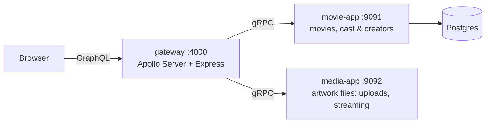

# svelte-kotlin-try

A movie catalogue: Svelte (TypeScript) frontend, an Apollo GraphQL gateway, and Kotlin Spring Boot services that talk gRPC.

## AI Disclaimer

This project is AI assisted using design plans with human vetting for the most part.

## Design docs

- [`docs/initial-setup-plan.md`](docs/initial-setup-plan.md): project structure and tooling
- [`docs/database-design.md`](docs/database-design.md): tables, migrations and search indexes
- [`docs/backend-design.md`](docs/backend-design.md): service behaviour, gRPC contracts and the GraphQL schema
- [`docs/frontend-design.md`](docs/frontend-design.md): pages, data loading, progress feedback and layout
- [`docs/unit-test-plan.md`](docs/unit-test-plan.md): what the tests cover

## Architecture



| Folder | What | Stack |
|---|---|---|
| `frontend/` | Web app | SvelteKit 3, Svelte 5, TypeScript, Vitest |
| `gateway/` | GraphQL API for the browser; calls the services over gRPC | Node, Apollo Server 5, Express 5 |
| `backend/` | Gradle multi-project with both services | Kotlin, Spring Boot 4.1, gRPC (coroutine stubs) |
| `infra/` | Postgres init script: the `movie` role, schema and `pg_trgm` | Postgres 18 |

Each service owns its gRPC contract in a `-proto` module (e.g. `backend/movie/movie-proto/src/main/proto`), which other services consume. The gateway reads the same `.proto` files and generates its TypeScript types from them on every `npm run dev`; `gateway/proto` only holds `buf/validate/validate.proto`, which the contracts import.

## Run

Requires Docker for Postgres, a JDK (17+, used to run Gradle; JDK 25 is downloaded automatically) and Node.js 24+. Run each command in its own terminal, starting from the repo root.

```bash
# 1. Postgres on port 5433. The init script creates the movie role and schema.
docker compose up
# Or, to also add sample movies and people to an empty database once movie-app has created the tables:
docker compose --profile seed up

# 2. Backend services. Artwork is stored in ~/.movie-app/media.
cd backend && ./gradlew :movie:movie-app:bootRun
cd backend && ./gradlew :media:media-app:bootRun

# 3. Gateway
cd gateway && npm install && npm run dev        # http://localhost:4000/graphql

# 4. Frontend
cd frontend && npm install && npm run dev       # http://localhost:5173
```

## Tests

```bash
cd backend && ./gradlew test   # repository tests use the compose Postgres, so start it first
cd frontend && npm test
```