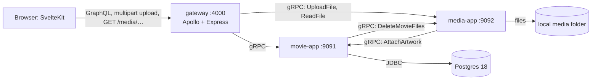
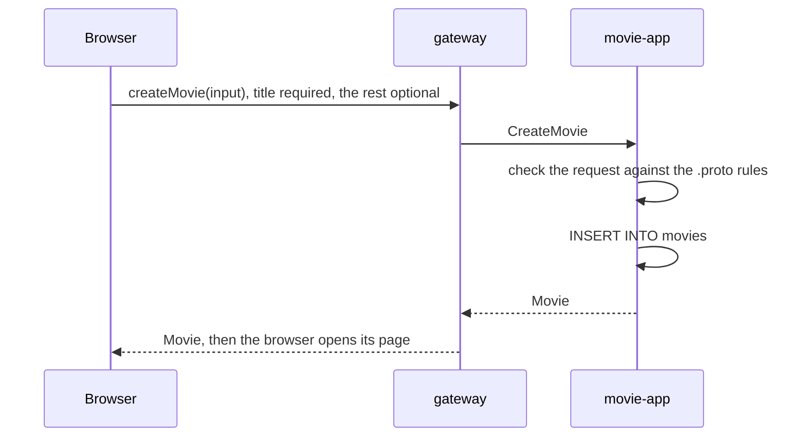
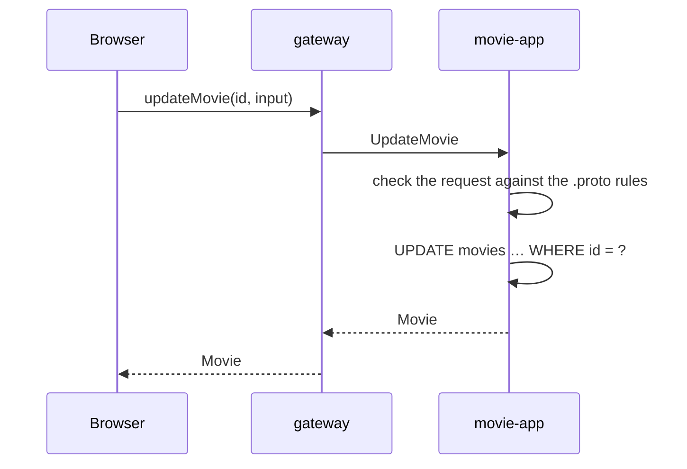
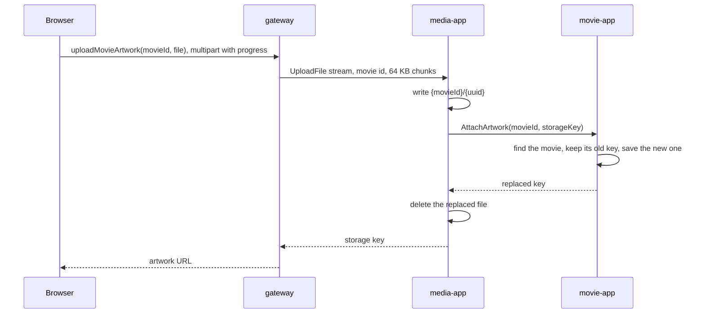
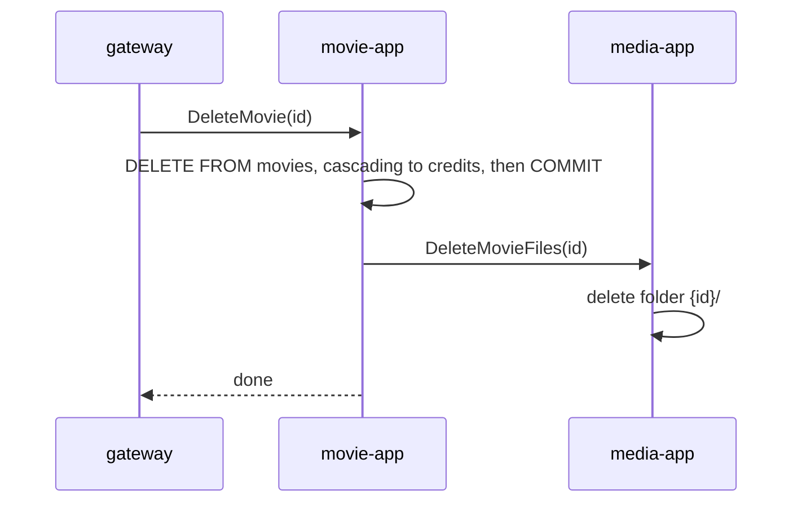
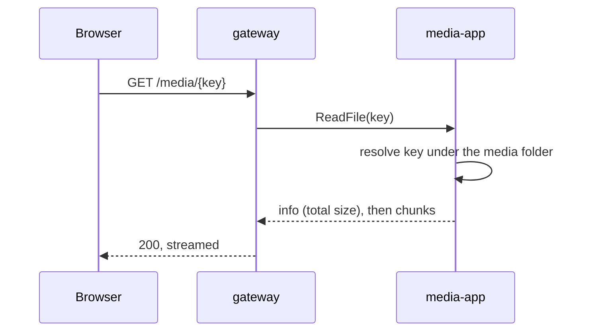

# Backend design

Status: **built**. Tables, keys and indexes are in [database-design.md](database-design.md); this doc covers the services, their gRPC contracts and how requests flow through them.

---

## 1. Services



| Service | Owns | Calls |
|---|---|---|
| **gateway** (Node, TypeScript) | the GraphQL schema the frontend uses; the `/media/*` HTTP route | movie-app, media-app |
| **movie-app** (Kotlin) | all data and every movie rule: movies, people, credits, search, and which file is each movie's artwork | Postgres, media-app |
| **media-app** (Kotlin) | the files: storing, reading, deleting | movie-app |

**The gateway only routes.** Each GraphQL resolver makes at most one gRPC call to one service, and calls for the same data across a page are batched into one (§5). The gateway translates GraphQL to gRPC, builds media URLs from storage keys and maps gRPC errors to GraphQL errors; it makes no decisions and never combines services.

**The services call each other for the steps that involve both.** media-app records stored artwork with movie-app (`AttachArtwork`); movie-app has media-app delete a deleted movie's files (`DeleteMovieFiles`).

**File bytes take one hop.** Uploads stream gateway → media-app and downloads stream media-app → gateway. movie-app and media-app only exchange small messages (ids and keys), never file contents.

---

## 2. Inside the services

### movie-app

```
com.backend.movie
├── MovieApplication.kt
├── client/                         the call to media-app
│   └── MediaApi.kt
├── controller/                     gRPC endpoints: proto ⇄ Kotlin mapping
│   ├── MovieGrpcController.kt
│   ├── PersonGrpcController.kt
│   ├── CreditGrpcController.kt
│   ├── GrpcExceptionHandler.kt     request validation; exceptions → gRPC statuses
│   └── ProtoMappers.kt             proto ⇄ Kotlin conversions
├── entities/                       table rows
│   ├── Movie.kt
│   ├── Person.kt
│   └── Credit.kt
├── enums/
│   └── CreditType.kt
├── exception/                      used by the controllers, services and the exception handler
│   └── Exceptions.kt
├── model/                          plain types that aren't table rows
│   ├── MovieFilter.kt              search input
│   ├── Page.kt                     a page of items + totalCount
│   └── CreditRows.kt               results of the credit joins
├── repository/                     Spring Data JDBC repositories + hand-written SQL
│   ├── MovieRepository.kt
│   ├── PersonRepository.kt
│   └── CreditRepository.kt
└── service/                        business rules, transactions
    ├── MovieService.kt
    ├── PersonService.kt
    ├── CreditService.kt
    └── Search.kt                   search patterns and page offsets
```

- **Each layer calls only the one below.** The controller is the only code that sees movie-proto classes; `MediaApi` is the only code that sees media-proto ones. Services and their tests work with plain Kotlin types, and tests mock `MediaApi` and the repositories.
- **Blocking JDBC in `suspend` handlers.** grpc-kotlin handlers are `suspend` functions, but JDBC blocks its thread. The `rpc(request) { }` wrapper around each controller method runs the service call in `withContext(Dispatchers.IO)`, the coroutine thread pool meant for blocking work. Service functions stay ordinary (non-`suspend`) blocking code. For the same reason `MediaApi` uses grpc-java's **blocking** stub: it's called from those ordinary service functions.
- **Validation** rules are written on the `.proto` fields as `(buf.validate.field)` options, and [protovalidate](https://protovalidate.com) checks each request against them before the controller method runs. A bad request never reaches the service, and every broken rule is collected, so a form can show all its errors at once. The rules are the "Rule" column of database-design.md §3.
  - Form fields use CEL rules with their own message (`"Title is required"`); ids, paging and the credit type use the built-in rules (`string.uuid`, `int32.gte`, `required`) and their default messages, since only a bug in the gateway breaks those.
  - One rule can't be written in the `.proto`: a release date in the right shape for a day that doesn't exist (2025-02-30). `releaseDateOrNull` in `MovieGrpcController.kt` catches it and throws the same kind of error.
- **The call to media-app happens after the commit.** No service function uses `@Transactional`: each write is a single statement that commits on its own, and `@Version` guards the read-then-save updates. So in `deleteMovie` the row's delete has committed before `MediaApi` is called.

| Repository | From Spring Data | Hand-written SQL (`@Query`) |
|---|---|---|
| `MovieRepository` | `save` (insert or update), `findById`, `deleteById` | search page + count, filtered by title, cast name and creator name (§3.7) |
| `PersonRepository` | `save` (insert or update), `findById`, `deleteById` | search page + count |
| `CreditRepository` | `save` (always insert), `deleteById` | the credits of many movies joined with people, the credits of many people joined with movies |

### media-app

```
com.backend.media
├── MediaApplication.kt
├── client/                         the call to movie-app
│   └── MovieApi.kt
├── controller/                     gRPC endpoints
│   ├── MediaGrpcController.kt
│   └── GrpcExceptionHandler.kt     request validation; exceptions → gRPC statuses
├── exception/
│   └── Exceptions.kt
├── service/                        uploads, reads in chunks, deletes
│   └── MediaService.kt
└── storage/                        reads, writes and deletes files under the media folder
    └── FileStorage.kt
```

media-app has no database; its only state is the files. As in movie-app, `MovieApi` is the only code that sees movie-proto classes, and tests mock it.

| Folder (under `~/.movie-app/media`) | Holds |
|---|---|
| `{movieId}/{uuid}` | a movie's artwork, or a file still being uploaded |

- Grouping by `{movieId}/` makes deleting all of a movie's files one folder delete.
- Every file gets a new uuid, so a replaced file has a new URL and a browser never shows a stale cached copy.

---

## 3. Flows

Files are put in place before a row points at them, and removed only after no row does. The worst a failure can leave is a file nobody points at.

Concurrent edits aren't guarded: when two people edit the same row, the last save wins.

### 3.1 Create a movie



- **Validate** every field before touching the database. Any broken rule → `INVALID_ARGUMENT`, nothing written.
- Postgres fills `id` with `uuidv7()`.
- The movie exists from here on, so everything else (artwork, credits) attaches to a real id.

### 3.2 Edit a movie's fields



- The form sends back every field (an update replaces the whole record). The artwork isn't part of the form and stays as it is.
- Unknown id → `NOT_FOUND`.

### 3.3 Upload artwork



1. **The browser** checks the file's extension (`.jpg`, `.jpeg`, `.png`) and size (5 MB or smaller), then sends it in one GraphQL multipart request. `XMLHttpRequest.upload.onprogress` drives the progress bar.
2. **The gateway** forwards the file as it arrives, respecting gRPC back-pressure, so the browser's progress tracks the real upload. The first message is the movie id; every later one is a 64 KB chunk, well under gRPC's 4 MB message limit. The gateway ends the stream once the whole file is sent. If the browser disconnects, the gateway cancels the call instead, and media-app stores nothing.
3. **media-app** writes the chunks to `{movieId}/{uuid}` without checking the content. No row points at the file until step 4. An interrupted upload's file is deleted, but its `{movieId}/` folder can stay behind, empty.
4. **media-app records it** with `AttachArtwork`. movie-app saves the new key on the movie and returns the previous one, or nothing if the movie had no artwork.
5. **media-app tidies up:**
   - success → deletes the replaced file, if any. The row stopped pointing at it in step 4;
   - `AttachArtwork` fails (unknown movie, movie-app down) → deletes the file it just stored and returns that error.

Artwork can be replaced but not removed.

### 3.4 Delete a movie



- Unknown id → `NOT_FOUND`.
- **Rows first, then files.** If media-app is down, the movie is still deleted and movie-app logs the leftover folder.

### 3.5 Add or remove a credit

A credit is how a person becomes cast or a creator on a movie.

| Operation | SQL | Errors |
|---|---|---|
| `addCredit(movieId, personId, type)` | `INSERT INTO credits` | `pk_credits` → `ALREADY_EXISTS` ("Already credited as cast on this movie"); `fk_credits_*` → `NOT_FOUND` |
| `removeCredit(movieId, personId, type)` | `DELETE … WHERE movie_id = ? AND person_id = ? AND credit_type = ?` | none. Removing a credit that's already gone succeeds, so a double click shows no error |

A credit is only its key, so there's no `UpdateCredit`: changing one is remove + add.

### 3.6 Show artwork



- movie-app returns each movie's `artwork_key` with the movie; the gateway turns it into `{PUBLIC_URL}/media/{key}`.
- The first message gives the gateway the size for `Content-Length`. Files have no stored type, so the response has no `Content-Type`, and the browser reads the image type from the bytes. A missing file → `404`, and a service that's down → `503`.
- **Caching:** `Cache-Control: public, max-age=31536000, immutable`, safe because each key holds one fixed file forever.
- **Path safety:** media-app resolves the key under the media folder and returns `NOT_FOUND` for anything outside it (`..`, absolute paths).

### 3.7 List and search

The movies and people pages each have their own list and search box. With no search, a page shows everything.

- `movies(search, castName, creatorName, page, pageSize)` → `ListMovies`: one query each for the page of movies and the total count.
- `people(search, page, pageSize)` → `ListPeople`: one query each for the page of people and the total count.
- **Credits are fetched only when a query asks for them,** through `ListCreditsByMovies` and `ListCreditsByPeople` (§5).
- **The search box syntax** belongs to the browser: `heat cast:david creator:"michael mann"` is split into `search`, `castName` and `creatorName` before the request is sent. Only `cast:` and `creator:` are recognised, anything else stays part of the title search, a space after the colon is allowed, names with spaces need quotes, and if a filter is repeated the last one wins.
- **Movie search is an AND search:** a movie must match every value given, and an empty value is skipped. All matching is `ILIKE` on part of the text, so `cast:david` finds every movie crediting anyone named David, and a movie crediting two Davids appears once:

  ```sql
  WHERE (:titlePattern = '' OR m.title ILIKE :titlePattern)
    AND (:castPattern = '' OR EXISTS (
          SELECT 1 FROM credits c JOIN people p ON p.id = c.person_id
          WHERE c.movie_id = m.id AND c.credit_type = 'CAST'
            AND p.name ILIKE :castPattern))
    -- the same EXISTS for 'CREATOR' with :creatorPattern
  ```

  Each pattern is built by the service, such as `%david%`, or is empty for no filter.

- **People search** matches `name` the same way, with no filters.
- **Input handling:** values are trimmed, and `%`, `_` and `\` are escaped, or searching `100%` would match everything.
- **Sorting:** a title or name term of 3 or more characters ranks by `similarity()`. Otherwise results sort by title or name, because similarity ranking means nothing for one or two letters. `id` is always the last sort column: titles and names can repeat, and without it those rows could swap places between pages. A movie's credits sort by name.
- **Paging** by offset: `page` (from 0), `pageSize` (1–100, default 20) and a `totalCount` for page numbers. Out-of-range values are `INVALID_ARGUMENT`. The offset is a `Long`, so a huge `page` returns an empty page instead of overflowing.

### 3.8 Create, edit or delete a person

| Operation | SQL | Errors |
|---|---|---|
| `createPerson(input)` | `INSERT INTO people` | a broken rule → `INVALID_ARGUMENT` |
| `updatePerson(id, input)` | `UPDATE people … WHERE id = ?` | a broken rule → `INVALID_ARGUMENT`; unknown id → `NOT_FOUND` |
| `deletePerson(id)` | `DELETE FROM people`, cascading to their credits | unknown id → `NOT_FOUND` |

- A new person has no role until they're credited on a movie (§3.5).
- The form sends back every field, because an update replaces the whole record.
- Deleting a person removes them from every movie they're credited on. The movies stay.

### Failures at a glance

| What fails | Result | Left behind |
|---|---|---|
| Validation (blank title, malformed id) | `BAD_USER_INPUT`, nothing written | nothing |
| Upload interrupted | nothing saved; media-app deletes the unfinished file | nothing |
| `AttachArtwork` (unknown movie, movie-app down) | that error; the movie keeps its previous file, media-app deletes the new one | an orphan file if that delete also fails |
| Deleting a replaced file | success | an orphan file |
| `DeleteMovieFiles` | success, logged | the movie's folder |

---

## 4. gRPC contracts

UUIDs travel as strings, checked by a `string.uuid` rule (a malformed one is `INVALID_ARGUMENT`). Nullable fields use proto3 `optional`, so "not set" and "empty" differ. Timestamps are `google.protobuf.Timestamp`; `release_date` is an ISO `YYYY-MM-DD` string.

`movie-proto` → package `movie`, one file per service: `movie/MovieService.proto`, `movie/PersonService.proto`, `movie/CreditService.proto`.
- Each file holds its service and every message it uses, split by comment banners into three sections: the service, the data shapes (such as `Movie` and `MovieFields`), and the requests and responses.
- File names are PascalCase, matching the service inside them.

| Service | RPC | Notes |
|---|---|---|
| `MovieService` | `ListMovies(query, cast_name, creator_name, page, page_size)` | returns one page and `total_count` |
| | `GetMovie`, `CreateMovie(fields)`, `UpdateMovie(id, fields)`, `DeleteMovie(id)` | |
| | `AttachArtwork(movie_id, storage_key)` | called by media-app; returns the replaced `storage_key` |
| `PersonService` | `ListPeople(query, page, page_size)`, `GetPerson`, `CreatePerson(fields)`, `UpdatePerson(id, fields)`, `DeletePerson(id)` | |
| `CreditService` | `AddCredit`, `RemoveCredit` | |
| | `ListCreditsByMovies(movie_ids)` | at most 100 ids; returns movie id, person id, name and type, for `Movie.credits` |
| | `ListCreditsByPeople(person_ids)` | at most 100 ids; returns person id, movie id, title and type, for `Person.credits` |

`media-proto` → package `media`, laid out the same way in `media/MediaService.proto`:

| RPC | Called by | Notes |
|---|---|---|
| `UploadFile` | gateway | client-streaming; a `oneof` lets the movie id and the chunks share one message type; returns the stored file's `storage_key` |
| `ReadFile(storage_key)` | gateway | server-streaming; first message `info { total_size }`, then chunks |
| `DeleteMovieFiles(movie_id)` | movie-app | idempotent |

- Each gRPC service gets its own controller class (`MovieGrpcController`, `PersonGrpcController`, `CreditGrpcController`, `MediaGrpcController`).
- `CreditType`'s 0 value means "not set", and the `required` rule rejects it as `INVALID_ARGUMENT`, so a forgotten field can't pass as a real value.
- Both contracts import `buf/validate/validate.proto`. It's inside the protovalidate jar, which the protobuf Gradle plugin unpacks for `protoc`.
- Each service depends on the other's `-proto` module for its client stubs.
- The gateway reads the `.proto` files straight from `movie-proto` and `media-proto` by relative path, so there's one copy of each contract. `gateway/proto` only holds a copy of `buf/validate/validate.proto`, because the contracts import it; the gateway only needs it to parse them, and never checks the rules.

---

## 5. Gateway

### GraphQL schema

```graphql
scalar Upload

type Query {
  movies(search: String, castName: String, creatorName: String, page: Int = 0, pageSize: Int = 20): MoviePage!
  movie(id: ID!): Movie
  people(search: String, page: Int = 0, pageSize: Int = 20): PersonPage!
  person(id: ID!): Person
}

type Mutation {
  createMovie(input: MovieInput!): Movie!
  updateMovie(id: ID!, input: MovieInput!): Movie!
  deleteMovie(id: ID!): Boolean!
  "Returns the new artwork's URL."
  uploadMovieArtwork(movieId: ID!, file: Upload!): String!
  createPerson(input: PersonInput!): Person!
  updatePerson(id: ID!, input: PersonInput!): Person!
  deletePerson(id: ID!): Boolean!
  addCredit(movieId: ID!, personId: ID!, type: CreditType!): Boolean!
  removeCredit(movieId: ID!, personId: ID!, type: CreditType!): Boolean!
}

input MovieInput {
  title: String!
  synopsis: String
  releaseDate: String
  runtimeMinutes: Int
}

input PersonInput {
  name: String!
  bio: String
}

enum CreditType { CAST, CREATOR }

type MoviePage { items: [Movie!]!, totalCount: Int! }
type PersonPage { items: [Person!]!, totalCount: Int! }

type Movie {
  id: ID!
  title: String!
  synopsis: String
  releaseDate: String
  runtimeMinutes: Int
  artworkUrl: String
  credits: [MovieCredit!]!
  createdAt: String!
  updatedAt: String!
}

type MovieCredit { personId: ID!, name: String!, type: CreditType! }

type Person {
  id: ID!
  name: String!
  bio: String
  credits: [PersonCredit!]!
  createdAt: String!
  updatedAt: String!
}

type PersonCredit { movieId: ID!, title: String!, type: CreditType! }
```

### Where each field comes from

Every `Query` and `Mutation` field has a resolver that makes one gRPC call. The only nested fields with resolvers are the two that need a join, and they run only when a query asks for them.

| Field | Comes from | Extra gRPC call |
|---|---|---|
| `Movie` plain fields (`title`, `artworkUrl`, …) | the `movies` row | none |
| `Movie.credits` | `credits` joined with `people`, through a loader | `ListCreditsByMovies`, once per request |
| `Person` plain fields | the `people` row | none |
| `Person.credits` | `credits` joined with `movies`, through a loader | `ListCreditsByPeople`, once per request |

- **Fields in the same row travel together.** Asking for only `id` and `title` still returns the whole row, and Apollo drops the rest. Reading the row is the cost, and it's paid either way.
- **Credits use DataLoader.** Each `load(id)` in a request is collected, and one RPC fetches them all, so a page of 100 makes the same one extra call as a page of 1. Each request gets new loaders, so cached results are never shared between requests. A movie or person with no credits gets an empty list.
- `MovieCredit` and `PersonCredit` hold only basic values rather than a full `Person` or `Movie`, so queries can't nest indefinitely.
- **If the credits call fails, the page's movies fail with it,** because `credits` is non-null. Only pages that ask for credits are affected.
- **The gateway maps each gRPC response to these types:** `artwork_key` becomes `artworkUrl`; `Timestamp` becomes an ISO string. Field names need no mapping: the proto loader's `keepCase: false` turns `total_count` into `totalCount`.
- `addCredit` / `removeCredit` return `Boolean`; the movie page refetches `movie(id)` afterwards.
- `movie(id)` returns `null` for an unknown id; mutations on an unknown id return a `NOT_FOUND` error.

### Uploads

Apollo Server has no built-in file uploads, so the gateway adds the GraphQL multipart request spec (`graphql-upload-minimal`) in front of Apollo.

Only the frontend checks files: their size (`file.size`, 5 MB or smaller) and extension (`file.name`: `.jpg`, `.jpeg`, `.png`), before uploading. The gateway and media-app don't check them.

Apollo's CSRF protection requires the browser to send an `apollo-require-preflight` header on uploads.

### Deadlines

Every gRPC call has a deadline: 5 s for normal calls; `UploadFile` and `ReadFile` get 5 minutes, since they last as long as the transfer. Before either one starts, the gateway waits up to 5 s for a connection, so a service that's down fails quickly. Calls between movie-app and media-app use 5 s.

---

## 6. Errors

| Situation | gRPC status | GraphQL `extensions.code` | The user sees |
|---|---|---|---|
| A value rule broken (blank title, malformed id) | `INVALID_ARGUMENT` | `BAD_USER_INPUT` | every broken rule in one message, joined with "; ", e.g. "Title is required; Runtime must be 1 to 1000 minutes" |
| Unknown id | `NOT_FOUND` | `NOT_FOUND` | "This movie no longer exists" |
| Duplicate credit (`pk_credits`) | `ALREADY_EXISTS` | `CONFLICT` | "Already credited as cast on this movie" |
| Another save changed the row first (`@Version`) | `ABORTED` | `CONFLICT` | "Someone else changed this at the same time. Reload and try again." |
| A service unreachable, or a deadline passed | `UNAVAILABLE` / `DEADLINE_EXCEEDED` | `SERVICE_UNAVAILABLE` | "Something went wrong, try again" |
| Anything else | `INTERNAL` | `INTERNAL_SERVER_ERROR` | a generic message; details only in the logs |

- In each Kotlin service, `GrpcExceptionHandler.kt` has an `rpc(request) { }` wrapper around every controller method. It validates the request, then turns exceptions into statuses, so controllers and services just throw `ValidationException`, `NotFoundException` and so on. media-app's `UploadFile` is a stream, so it validates each message as it arrives.
- Every error is a plain status with a description, and the gateway passes the description on as the GraphQL message. The frontend shows it in a banner and checks its own fields before sending, so errors don't say which field broke.
- Database errors are matched by **constraint name** (`pk_credits`, `fk_credits_person_id`, …), which is why the constraints are named. `CreditService` does the matching, because it knows the credit type the message needs.
- When media-app gets an error from `AttachArtwork`, it passes `NOT_FOUND` on with its message and turns anything else into `UNAVAILABLE`.

---

## 7. Configuration

| Setting | Where | Default |
|---|---|---|
| movie-app datasource | `application.properties` | `jdbc:postgresql://localhost:5433/app` |
| movie-app → media-app | `spring.grpc.client.channel.media.target` | `localhost:9092` |
| media-app → movie-app | `spring.grpc.client.channel.movie.target` | `localhost:9091` |
| media root | `media.storage.root` | `~/.movie-app/media` |
| gateway → services | `MOVIE_SERVICE_ADDR`, `MEDIA_SERVICE_ADDR` | `localhost:9091`, `localhost:9092` |
| gateway's public URL (for media URLs) | `PUBLIC_URL` | `http://localhost:4000` |

gRPC connects on the first call, so either service can start first.

---

## 8. Tests

The test plan is in [unit-test-plan.md](unit-test-plan.md).

---

## 9. At scale (README notes)

| At scale you'd… | Here we… | Why |
|---|---|---|
| Upload straight to S3 with a presigned URL, serve through a CDN | Stream through the gateway to a local folder | No extra infrastructure to run. `artwork_key` becomes an S3 key, so the database doesn't change. |
| Make file clean-up reliable with an outbox table that retries deletes | Delete files best-effort after the commit and accept rare orphans | Orphans are harmless: nothing points at them. |
| Reject conflicting edits with a version column | Let the last save win | The spec has no concurrent-editing requirement. |
| Page by keyset (`WHERE id > ?`) | Page by offset | Offsets get slow only on deep pages of large tables, and they give page numbers. |
| Search with OpenSearch, cast names embedded in each movie document | Use Postgres trigram indexes | Fast enough at this size, and nothing to keep in sync. |
| Add auth and roles | Have no users | The spec has no users. |

---

## 10. Sample data

`docker compose --profile seed up` also starts a `seed` service, which adds sample movies, people and credits (`infra/postgres/seed`). It waits for movie-app to create the tables, and only adds data to an empty database, so a later run can't bring back deleted rows. It adds no artwork, because files aren't in the database.
