# Backend design

Status: **proposal, waiting for approval**. Tables, keys and indexes are in [database-design.md](database-design.md); this doc covers the services, their gRPC contracts and how requests flow through them.

---

## 1. Services

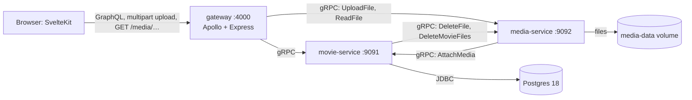

| Service | Owns | Calls |
|---|---|---|
| **gateway** (Node, TypeScript) | the GraphQL schema the frontend uses; the `/media/*` HTTP route | movie-service, media-service |
| **movie-service** (Kotlin) | all data and every movie rule: movies and their draft/published status, people, credits, search, the `movie_media` records, and when files are attached, replaced or deleted | Postgres, media-service |
| **media-service** (Kotlin) | the files: checking type and size, storing, reading, deleting | movie-service |

**The gateway only routes.** Each GraphQL resolver makes at most one gRPC call to one service, and calls for the same data across a page are batched into one (§5). The gateway translates GraphQL to gRPC, builds media URLs from storage keys and maps gRPC errors to GraphQL errors; it makes no decisions and never combines services.

**The services call each other for the steps that involve both.** media-service records a stored file with movie-service (`AttachMedia`); movie-service has media-service delete the files of a removed record (`DeleteFile`, `DeleteMovieFiles`).

**File bytes take one hop.** Uploads stream gateway → media-service and downloads stream media-service → gateway. movie-service and media-service only exchange small messages (keys, sizes), never file contents.

---

## 2. Inside the services

### movie-service

```
com.backend.movie
├── MovieApplication.kt
├── client/                         calls to media-service
│   └── MediaClient.kt
├── controller/                     gRPC endpoints: proto ⇄ Kotlin mapping, nothing else
│   ├── MovieGrpcController.kt
│   ├── PersonGrpcController.kt
│   ├── CreditGrpcController.kt
│   ├── GrpcExceptionHandler.kt     exceptions → gRPC statuses
│   └── ProtoMappers.kt             proto ⇄ Kotlin conversions
├── entities/                       table rows
│   ├── Movie.kt
│   ├── Person.kt
│   ├── Credit.kt
│   └── MovieMedia.kt
├── enums/
│   ├── MovieStatus.kt
│   ├── CreditType.kt
│   └── MediaKind.kt
├── exception/                      used by the services and the exception handler
│   └── Exceptions.kt
├── model/                          plain types that aren't table rows
│   ├── MovieFilter.kt              search input
│   ├── Page.kt                     a page of items + totalCount
│   ├── MovieWithMedia.kt           a movie plus its media records
│   └── CreditRows.kt               results of the credit joins
├── repository/                     Spring Data JDBC repositories + hand-written SQL
│   ├── MovieRepository.kt
│   ├── PersonRepository.kt
│   ├── CreditRepository.kt
│   └── MovieMediaRepository.kt
└── service/                        validation, business rules, transactions
    ├── MovieService.kt
    ├── PersonService.kt
    ├── CreditService.kt
    └── Validation.kt               the value rules
```

Tests mirror these packages. Repository tests use Testcontainers.

- **Each layer calls only the one below.** The controller is the only code that sees movie-api proto classes; `MediaClient` is the only code that sees media-api ones. Services and their tests work with plain Kotlin types, and tests swap `MediaClient` for a fake.
- **Blocking JDBC in `suspend` handlers.** grpc-kotlin handlers are `suspend` functions, but JDBC blocks its thread. Each controller method wraps its service call in `withContext(Dispatchers.IO)`, the coroutine thread pool meant for blocking work. Service functions stay ordinary (non-`suspend`), so `@Transactional` works as usual: it binds the transaction to the current thread, and a coroutine can switch threads at every `suspend` point. For the same reason `MediaClient` uses grpc-java's **blocking** stub: it's called from those ordinary service functions.
- **Validation** runs in the service before any SQL or file call and collects *every* broken rule, so a form can show all its errors at once. The rules are the "Rule" column of database-design.md §3.
- **Calls to media-service happen after the commit.** A function that changes rows and then deletes files uses `TransactionTemplate` for the database step and calls `MediaClient` after it. `@Transactional` wouldn't work here: it commits only when the function returns, and a `@Transactional` function called from the same class gets no transaction at all.

| Repository | From Spring Data | Hand-written SQL (`@Query`) |
|---|---|---|
| `MovieRepository` | `save` (insert, or update with the version check; also used to publish), `findById`, `delete` (with the version check) | search page + count, filtered by status, title, cast name and creator name (§3.12) |
| `PersonRepository` | `save`, `findById`, `delete`, as for movies | search page + count |
| `CreditRepository` | | insert (the id is never null, so `save()` would run an UPDATE), delete, the credits of many movies joined with people, the credits of many people joined with movies |
| `MovieMediaRepository` | find by movie ids | upsert returning the replaced key (§3.3); delete returning the removed key (§3.4) |

### media-service

```
com.backend.media
├── MediaApplication.kt
├── client/                         the call to movie-service
│   └── MovieClient.kt
├── controller/                     gRPC endpoints
│   ├── MediaGrpcController.kt
│   └── GrpcExceptionHandler.kt     exceptions → gRPC statuses
├── enums/
│   └── MediaKind.kt                its own copy, with size limits and allowed types
├── exception/
│   └── Exceptions.kt
├── service/                        file-type detection, size limits, the upload flow
│   ├── UploadService.kt
│   └── FileTypeDetector.kt
└── storage/                        reads, writes and moves files under /data/media
    └── FileStorage.kt
```

media-service has no database; its only state is the files. As in movie-service, `MovieClient` is the only code that sees movie-api classes, and tests swap it for a fake that returns a ready-made result. The services share no code, so each has its own `MediaKind`; the proto is the contract between them.

| Folder (on the `media-data` volume, `/data/media`) | Holds |
|---|---|
| `tmp/{uuid}` | files still being uploaded |
| `{movieId}/artwork/{uuid}.{jpg,png,webp}` | a movie's poster |
| `{movieId}/preview/{uuid}.{mp4,webm}` | its hover trailer |
| `{movieId}/full/{uuid}.{mp4,webm}` | its full video |

- Grouping by `{movieId}/` makes deleting all of a movie's files one folder delete.
- Every file gets a new uuid, so a replaced file has a new URL and a browser never shows a stale cached copy.

---

## 3. Flows

The same rule shapes every flow: **a database record never points at a missing file.** Files are put in place before a row points at them, and removed only after no row does. The worst a failure can leave is a file nobody points at.

A movie is either a **draft** or **published**. Drafts are where work in progress lives: a half-finished movie, with its uploads, stays in the Drafts list until it's published or deleted. Nothing the user made disappears on its own.

**Only drafts can be changed.** A published movie is read-only: its fields, files and credits can't be edited and it can't be deleted. To change one, unpublish it (§3.5), edit it, and publish it again. This way nothing changes underneath someone who is watching it. Any change to a published movie → `FAILED_PRECONDITION`: "Unpublish this movie to change it".

### 3.1 Create a draft

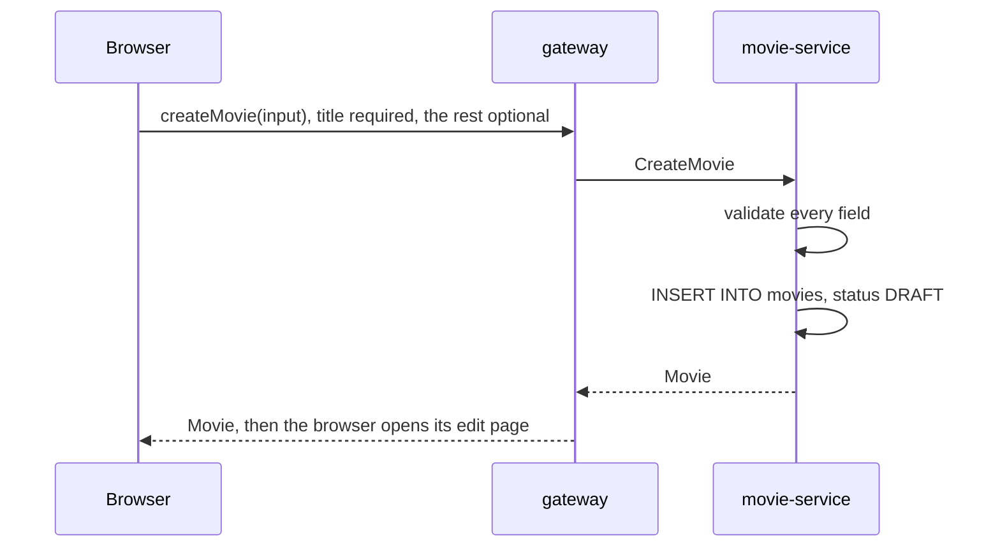

- **Validate** every field before touching the database. Any broken rule → `INVALID_ARGUMENT`, nothing written.
- Postgres fills `id` with `uuidv7()`; `version` starts at 0 and `status` at `DRAFT`.
- The movie exists from here on, so everything else (uploads, credits) attaches to a real id.

### 3.2 Edit a movie's fields

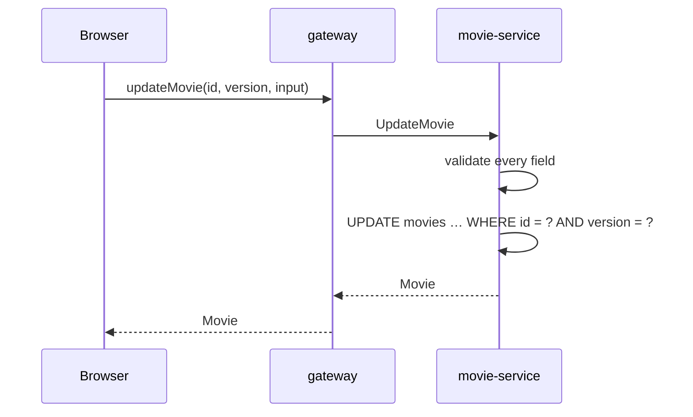

- The form sends back every field plus the `version` it loaded (an update replaces the whole record). Spring Data JDBC runs `UPDATE … WHERE id = ? AND version = ?` and bumps `version`.
- 0 rows means someone else saved first → `ABORTED` → GraphQL `CONFLICT`: "Someone else changed this movie. Reload to see their changes."
- **The status is checked before the version.** A published movie → `FAILED_PRECONDITION`, even if the form is also stale, because reloading wouldn't help until it's unpublished. Publishing and unpublishing bump `version`, so a form loaded before an unpublish gets `CONFLICT`.

### 3.3 Upload a file to a movie

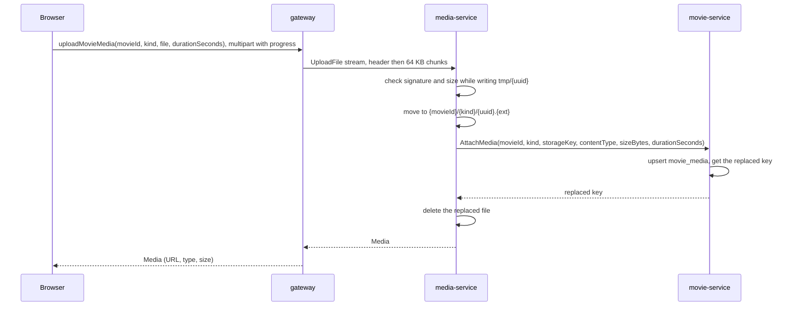

1. **The browser** sends the file in one GraphQL multipart request. `XMLHttpRequest.upload.onprogress` drives the progress bar. For videos it reads the duration from the file's metadata and sends it along.
2. **The gateway** forwards the file as it arrives, respecting gRPC back-pressure, so the browser's progress tracks the real upload. The first message is a header (`movie_id`, `kind`, `duration_seconds`); every later one is a 64 KB chunk, well under gRPC's 4 MB message limit.
3. **media-service** stores the file:
   - checks the first bytes against the file signatures allowed for the kind: JPEG, PNG, WebP for `ARTWORK`; MP4, WebM for `PREVIEW` / `FULL`. The browser's file name and claimed type are ignored; the type is read from the bytes. An empty file, or one too short to have a signature, fails this check;
   - counts bytes as they arrive and aborts with `INVALID_ARGUMENT` as soon as the total passes the kind's limit (ARTWORK 5 MB, PREVIEW 25 MB, FULL 500 MB);
   - writes to `tmp/{uuid}`, then moves it to `{movieId}/{kind}/{uuid}.{ext}` when the stream ends, so a half-written file never appears under a real key.
4. **media-service records it** with `AttachMedia`, sending the facts it measured (key, detected type, size). movie-service checks the movie exists and is a draft, and validates `duration_seconds` (positive, videos only), then upserts the `movie_media` row. Postgres 18's `RETURNING old.…` gives the replaced key in the same statement (null if the movie had no file of that kind):

   ```sql
   INSERT INTO movie_media (movie_id, kind, storage_key, content_type, size_bytes, duration_seconds)
   VALUES (:movieId, :kind, :storageKey, :contentType, :sizeBytes, :durationSeconds)
   ON CONFLICT (movie_id, kind) DO UPDATE
     SET storage_key = excluded.storage_key, content_type = excluded.content_type,
         size_bytes = excluded.size_bytes, duration_seconds = excluded.duration_seconds,
         updated_at = now()
   RETURNING old.storage_key
   ```
5. **media-service tidies up:**
   - success → deletes the replaced file, if any. The row stopped pointing at it in step 4;
   - `AttachMedia` fails (unknown movie, published movie, invalid duration, movie-service down) → deletes the file it just stored and returns that error.

Details:
- **The save finishes on the server.** Once the bytes have arrived, closing the tab doesn't stop the file being recorded; the edit page shows it next time.
- **The response is the file's info, not the whole movie.** The page updates that one image or video from it.
- **Attaching doesn't touch the movie's `version`.** Files aren't part of the edit form, so uploading a poster doesn't make someone's open form stale.
- **Draft check without a version.** Attaching locks the movie's row (`SELECT … FOR UPDATE`) while checking it's a draft, so a publish arriving at the same moment waits until the attach is done. The same applies to removing a file (§3.4) and to credits (§3.10).
- The edit page only offers uploads on drafts, so the published-movie rejection only happens if the movie is published while the file is uploading.

### 3.4 Remove a file

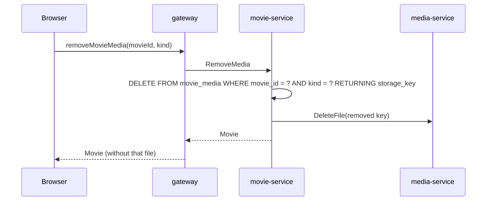

- Drafts only, like every change (§3 intro). Unknown movie → `NOT_FOUND`.
- The same order as a replace: the row is deleted and committed first, the file goes after.
- `RETURNING storage_key` gives the key of the deleted row, so there's no separate `SELECT` to find which file to delete.
- Removing a kind the movie doesn't have deletes 0 rows and returns nothing: success, no file call.

### 3.5 Publish and unpublish

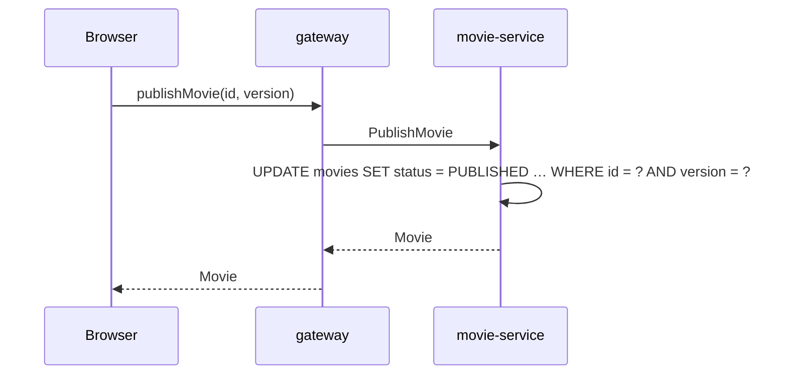

- **Any movie can be published.** A draft already satisfies every rule a movie has (a title is required from creation), so publishing is purely the user's decision.
- `unpublishMovie(id, version)` sets `DRAFT` again. The movie, its files and credits stay; it leaves the public list and becomes editable.
- **The status is checked first.** Publishing a published movie (or unpublishing a draft) changes nothing and succeeds whatever version was sent, so a double click shows no error.
- **Version check:** otherwise, you're publishing what you're looking at, not what someone changed a second ago. A mismatch is the usual `CONFLICT`. A real change bumps `version`.

### 3.6 Delete a movie

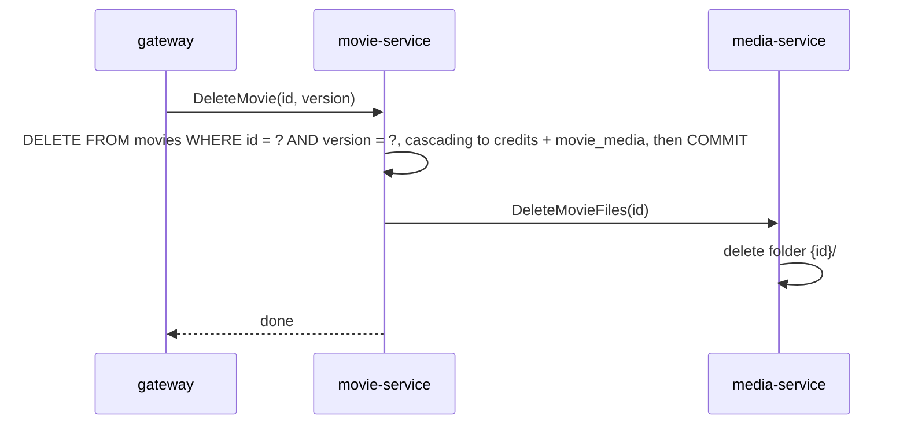

- Drafts only: a published movie → `FAILED_PRECONDITION`. Unknown id → `NOT_FOUND`.
- **Version check:** a delete removes the movie you were looking at, not one someone has edited since. A mismatch → `CONFLICT`.
- **Rows first, then files.** If media-service is down, the movie is still deleted and movie-service logs the leftover folder.
- Because movie-service does the clean-up, files go however the movie is deleted: through the UI, a script or any future caller.

### 3.7 Create a person

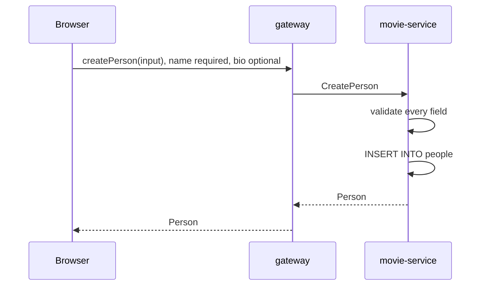

- Any broken rule (blank name, name over 200 characters, bio over 5000) → `INVALID_ARGUMENT`, nothing written.
- Postgres fills `id` with `uuidv7()`; `version` starts at 0.
- People have no status: a person is visible as soon as they're created, and is credited on movies separately (§3.10).
- Two people may share a name; there's no uniqueness rule on `name`.

### 3.8 Edit a person

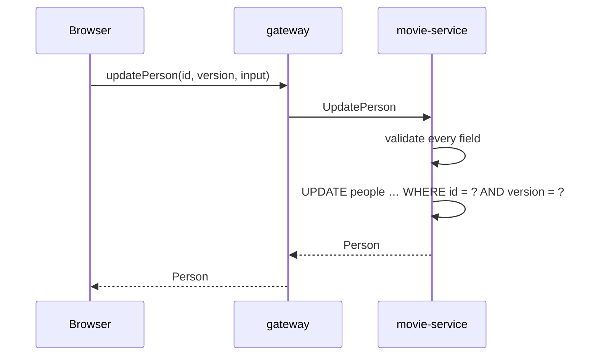

- The same as editing a movie (§3.2): the form sends every field plus the `version` it loaded, and 0 rows updated means someone else saved first → `CONFLICT`.
- Unknown id → `NOT_FOUND`.
- Every movie crediting this person shows the new name, since credits point at the person rather than copying their name.

### 3.9 Delete a person

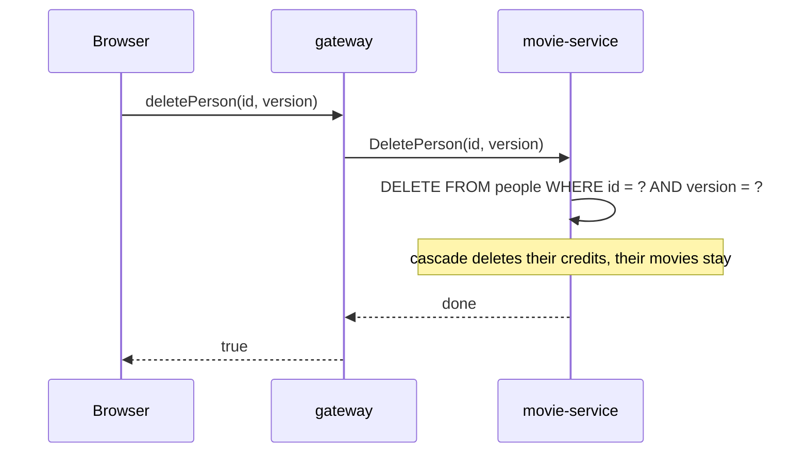

- Unknown id → `NOT_FOUND`; a stale version → `CONFLICT`.
- People have no files, so media-service isn't involved.
- This is allowed even if they're credited on a published movie. The cascade removes those credits too: the change belongs to the person, and the movie's fields and files stay as they are, so nobody's stream is affected.

### 3.10 Add or remove a credit

| Operation | SQL | Errors |
|---|---|---|
| `addCredit(movieId, personId, type)` | `INSERT INTO credits` | `pk_credits` → `ALREADY_EXISTS` ("Already credited as cast on this movie"); `fk_credits_*` → `NOT_FOUND` |
| `removeCredit(movieId, personId, type)` | `DELETE … WHERE movie_id = ? AND person_id = ? AND credit_type = ?` | unknown movie → `NOT_FOUND`. Removing a credit that's already gone succeeds, since the goal ("this credit doesn't exist") is met, and a double click shows no error |

- A credit is only its key, so there's no `UpdateCredit` (changing one is remove + add) and no version.
- Drafts only: adding or removing a credit on a published movie → `FAILED_PRECONDITION`, checked before the SQL above.

### 3.11 Show artwork and play video

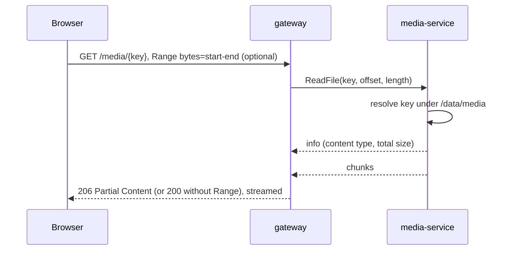

- movie-service returns each movie's `movie_media` rows with the movie; the gateway turns each `storage_key` into `{PUBLIC_URL}/media/{storageKey}`.
- The first `ReadFile` response carries the file's total size and content type, which the gateway needs for `Content-Length`, `Content-Range` and `Content-Type`.
- **`Range` support**, which lets a `<video>` seek and start before the whole file arrives: `Range: bytes=…` → `206 Partial Content`; a range past the end → `416`; no `Range` → `200` with the whole file.
- **Caching:** `Cache-Control: public, max-age=31536000, immutable`, safe because each key holds one fixed file forever.
- **Path safety:** media-service resolves the key under `/data/media` and returns `NOT_FOUND` for anything outside it (`..`, absolute paths) or under `tmp/`.

### 3.12 List and search

The movies and people pages each have their own list and search box. With no search, a page shows everything.

- `movies(search, castName, creatorName, status, page, pageSize)` → `ListMovies`: one query each for the page of movies, the total count and their media records.
  - `status` defaults to `PUBLISHED`, which is what the public list and search use. The Drafts page asks for `DRAFT`.
- `people(search, page, pageSize)` → `ListPeople`: one query each for the page of people and the total count.
- **Every returned movie includes its media.** One shared function takes a list of movies, loads their media with one query, and matches the rows to the movies in memory, so a page of 100 runs the same number of queries as a page of 1.
- **Credits are fetched only when a query asks for them,** through `ListCreditsByMovies` and `ListCreditsByPeople` (§5). A person's credits include each movie's status, so the UI can mark drafts.
- **The search box syntax** belongs to the browser: `heat cast:david creator:"michael mann"` is split into `search`, `castName` and `creatorName` before the request is sent. Only `cast:` and `creator:` are recognised, anything else stays part of the title search, names with spaces need quotes, and if a filter is repeated the last one wins.
- **Movie search is an AND search:** a movie must match every value given, and an empty value is skipped. All matching is `ILIKE` on part of the text, so `cast:david` finds every movie crediting anyone named David, and a movie crediting two Davids appears once:

  ```sql
  WHERE m.status = :status
    AND (:titlePattern = '' OR m.title ILIKE :titlePattern)
    AND (:castPattern = '' OR EXISTS (
          SELECT 1 FROM credits c JOIN people p ON p.id = c.person_id
          WHERE c.movie_id = m.id AND c.credit_type = 'CAST'
            AND p.name ILIKE :castPattern))
    -- the same EXISTS for 'CREATOR' with :creatorPattern
  ```

  Each pattern is built by the service, such as `%david%`, or is empty for no filter.

- **People search** matches `name` the same way, with no filters.
- **Input handling:** values are trimmed, and `%`, `_` and `\` are escaped, or searching `100%` would match everything.
- **Sorting:** a title or name term of 3 or more characters ranks by `similarity()`. Otherwise results sort by title or name, because similarity ranking means nothing for one or two letters. `id` is always the last sort column: titles and names can repeat, and without it those rows could swap places between pages. A movie's credits sort by name.
- **Paging** by offset: `page` (from 0), `pageSize` (1–100, default 20) and a `totalCount` for page numbers. Out-of-range values are `INVALID_ARGUMENT`. The offset is a `Long`, so a huge `page` returns an empty page instead of overflowing.

### 3.13 Unfinished work

- **A movie abandoned halfway** is a draft. It stays in the Drafts list, with its files and credits, until the user finishes and publishes it or deletes it.
- **An upload abandoned halfway** (tab closed during the transfer) never finished, so media-service deletes its temp file and nothing was saved.

### Failures at a glance

| What fails | Result | Left behind |
|---|---|---|
| Validation (blank title, wrong file type, too large) | `BAD_USER_INPUT`, nothing written | nothing |
| Version conflict on edit, publish or delete | `CONFLICT`, nothing written | nothing |
| Changing a published movie | `FAILED_PRECONDITION`, nothing written | nothing |
| Upload interrupted | nothing saved; media-service deletes the temp file | nothing |
| `AttachMedia` (unknown or published movie, movie-service down) | that error; the movie keeps its previous file, media-service deletes the new one | an orphan file if that delete also fails |
| Deleting a replaced or removed file | success | an orphan file |
| `DeleteMovieFiles` | success, logged | the movie's folder |

---

## 4. gRPC contracts

UUIDs travel as strings and are parsed in the controller (a malformed one is `INVALID_ARGUMENT`). Nullable fields use proto3 `optional`, so "not set" and "empty" differ. Timestamps are `google.protobuf.Timestamp`; `release_date` is an ISO `YYYY-MM-DD` string.

`movie-api` → `movie/v1/movie_service.proto` (package `movie.v1`):

| Service | RPC | Notes |
|---|---|---|
| `MovieService` | `ListMovies(query, cast_name, creator_name, status, page, page_size)` | returns one page and `total_count`; each movie includes its status and media records |
| | `GetMovie` | the same movie shape, as do all the movie RPCs below that return a movie |
| | `CreateMovie(fields)`, `UpdateMovie(id, version, fields)` | a new movie is a `DRAFT` |
| | `PublishMovie(id, version)`, `UnpublishMovie(id, version)` | |
| | `AttachMedia(movie_id, kind, storage_key, content_type, size_bytes, duration_seconds)` | called by media-service; returns the replaced `storage_key` |
| | `RemoveMedia(movie_id, kind)` | returns the movie |
| | `DeleteMovie(id, version)` | |
| `PersonService` | `ListPeople(query, page, page_size)`, `GetPerson`, `CreatePerson`, `UpdatePerson(id, version, …)`, `DeletePerson(id, version)` | |
| `CreditService` | `AddCredit`, `RemoveCredit` | |
| | `ListCreditsByMovies(movie_ids)` | at most 100 ids; returns movie id, person id, name and type, for `Movie.credits` |
| | `ListCreditsByPeople(person_ids)` | at most 100 ids; returns person id, movie id, title, status and type, for `Person.credits` |

`media-api` → `media/v1/media_service.proto` (package `media.v1`):

| RPC | Called by | Notes |
|---|---|---|
| `UploadFile` | gateway | client-streaming; a `oneof` lets the header (`movie_id`, `kind`, `duration_seconds`) and the chunks share one message type; returns the stored file's `storage_key`, `content_type`, `size_bytes`, `duration_seconds` |
| `ReadFile(storage_key, offset, length)` | gateway | server-streaming; first message `info { content_type, total_size }`, then chunks |
| `DeleteFile(storage_key)` | movie-service | idempotent |
| `DeleteMovieFiles(movie_id)` | movie-service | idempotent |

- Each gRPC service gets its own controller class (`MovieGrpcController`, `PersonGrpcController`, `CreditGrpcController`, `MediaGrpcController`).
- Each enum's 0 value means "not set", and is rejected as `INVALID_ARGUMENT`, so a forgotten field can't pass as a real value.
- Health checks use the standard gRPC health service, which Spring Boot registers automatically and compose's `grpc_health_probe` calls. The frontend doesn't check health.
- Each service depends on the other's `-api` module for its client stubs.

---

## 5. Gateway

### GraphQL schema

```graphql
scalar Upload

type Query {
  movies(search: String, castName: String, creatorName: String, status: MovieStatus = PUBLISHED, page: Int = 0, pageSize: Int = 20): MoviePage!
  movie(id: ID!): Movie
  people(search: String, page: Int = 0, pageSize: Int = 20): PersonPage!
  person(id: ID!): Person
}

type Mutation {
  createMovie(input: MovieInput!): Movie!
  updateMovie(id: ID!, version: Int!, input: MovieInput!): Movie!
  publishMovie(id: ID!, version: Int!): Movie!
  unpublishMovie(id: ID!, version: Int!): Movie!
  deleteMovie(id: ID!, version: Int!): Boolean!
  uploadMovieMedia(movieId: ID!, kind: MediaKind!, file: Upload!, durationSeconds: Int): Media!
  removeMovieMedia(movieId: ID!, kind: MediaKind!): Movie!
  createPerson(input: PersonInput!): Person!
  updatePerson(id: ID!, version: Int!, input: PersonInput!): Person!
  deletePerson(id: ID!, version: Int!): Boolean!
  addCredit(movieId: ID!, personId: ID!, type: CreditType!): Boolean!
  removeCredit(movieId: ID!, personId: ID!, type: CreditType!): Boolean!
}

input MovieInput {
  title: String!
  synopsis: String
  releaseDate: String
  runtimeMinutes: Int
}

input PersonInput {
  name: String!
  bio: String
}

enum MovieStatus { DRAFT, PUBLISHED }
enum MediaKind { ARTWORK, PREVIEW, FULL }
enum CreditType { CAST, CREATOR }

type MoviePage { items: [Movie!]!, totalCount: Int! }
type PersonPage { items: [Person!]!, totalCount: Int! }

type Movie {
  id: ID!
  title: String!
  synopsis: String
  releaseDate: String
  runtimeMinutes: Int
  status: MovieStatus!
  artwork: Media
  preview: Media
  video: Media
  credits: [MovieCredit!]!
  version: Int!
  createdAt: String!
  updatedAt: String!
}

type MovieCredit { personId: ID!, name: String!, type: CreditType! }

type Person {
  id: ID!
  name: String!
  bio: String
  credits: [PersonCredit!]!
  version: Int!
  createdAt: String!
  updatedAt: String!
}

type PersonCredit { movieId: ID!, title: String!, status: MovieStatus!, type: CreditType! }

type Media { url: String!, contentType: String!, sizeBytes: Float!, durationSeconds: Int }
```

### Where each field comes from

Every `Query` and `Mutation` field has a resolver that makes one gRPC call. The only nested fields with resolvers are the two that need a join, and they run only when a query asks for them.

| Field | Comes from | Extra gRPC call |
|---|---|---|
| `Movie` plain fields (`title`, `status`, `version`, …) | the `movies` row | none |
| `Movie.artwork`, `preview`, `video` | the movie's `movie_media` records, mapped by the gateway | none |
| `Movie.credits` | `credits` joined with `people`, through a loader | `ListCreditsByMovies`, once per request |
| `Person` plain fields | the `people` row | none |
| `Person.credits` | `credits` joined with `movies`, through a loader | `ListCreditsByPeople`, once per request |

- **Fields in the same row travel together.** Asking for only `id` and `title` still returns the whole row, and Apollo drops the rest. Reading the row is the cost, and it's paid either way.
- **Media comes with the movie.** It needs no join, and almost every view of a movie shows its artwork, so a loader would add a call to every list and save nothing.
- **Credits use DataLoader.** Each `load(id)` in a request is collected, and one RPC fetches them all, so a page of 100 makes the same one extra call as a page of 1. Each request gets new loaders, so cached results are never shared between requests. A movie or person with no credits gets an empty list.
- `MovieCredit` and `PersonCredit` hold only basic values rather than a full `Person` or `Movie`, so queries can't nest indefinitely.
- **If the credits call fails, the page's movies fail with it,** because `credits` is non-null. Only pages that ask for credits are affected.
- **The gateway maps each gRPC response to these types:** the `MovieMedia` records become `artwork` (`ARTWORK`), `preview` (`PREVIEW`) and `video` (`FULL`); `storage_key` becomes `url`; `Timestamp` becomes an ISO string; `int64` sizes become numbers. Field names need no mapping: the proto loader's `keepCase: false` turns `total_count` into `totalCount`.
- `addCredit` / `removeCredit` return `Boolean`; the movie page refetches `movie(id)` afterwards.
- `movie(id)` returns `null` for an unknown id; mutations on an unknown id return a `NOT_FOUND` error.
- `sizeBytes` is a `Float` because GraphQL's `Int` is 32-bit.

### Uploads

Apollo Server has no built-in file uploads, so the gateway adds the GraphQL multipart request spec (`graphql-upload-minimal`) in front of Apollo and caps files at the largest limit (500 MB). Apollo's CSRF protection then requires the browser to send an `apollo-require-preflight` header on uploads.

### Deadlines

Every gRPC call has a deadline: 5 s for normal calls; `UploadFile` and `ReadFile` get a long one, since they last as long as the transfer. Calls between movie-service and media-service use 5 s.

---

## 6. Errors

| Situation | gRPC status | GraphQL `extensions.code` | The user sees |
|---|---|---|---|
| A value rule broken (blank title, wrong file type, too large) | `INVALID_ARGUMENT` + a list of field errors | `BAD_USER_INPUT` + `fieldErrors` | one message per field, e.g. "Title must be 200 characters or fewer" |
| Unknown id | `NOT_FOUND` | `NOT_FOUND` | "This movie no longer exists" |
| Changing a published movie | `FAILED_PRECONDITION` | `FAILED_PRECONDITION` | "Unpublish this movie to change it" |
| Duplicate credit (`pk_credits`) | `ALREADY_EXISTS` | `CONFLICT` | "Already credited as cast on this movie" |
| Stale `version` on update, publish or delete | `ABORTED` | `CONFLICT` | "Someone else changed this. Reload." |
| A service unreachable, or a deadline passed | `UNAVAILABLE` / `DEADLINE_EXCEEDED` | `SERVICE_UNAVAILABLE` | "Something went wrong, try again" |
| Anything else | `INTERNAL` | `INTERNAL_SERVER_ERROR` | a generic message; details only in the logs |

- In each Kotlin service, `GrpcExceptionHandler.kt` has an `rpc { }` wrapper around every controller method. It turns exceptions into statuses, so services just throw `ValidationException`, `NotFoundException` and so on. Spring's own exception handling can't do this, because grpc-kotlin catches exceptions inside the coroutine.
- Field errors travel in the status's trailers: one `field-error` entry per broken rule, as `field=message`.
- Database errors are matched by **constraint name** (`pk_credits`, `fk_credits_person_id`, …), which is why the constraints are named. `CreditService` does the matching, because it knows the credit type the message needs.
- When one service gets an error from the other, it passes `INVALID_ARGUMENT`, `NOT_FOUND` and `FAILED_PRECONDITION` on with their message and turns anything else into `UNAVAILABLE`.

---

## 7. Configuration

| Setting | Where | Value in compose |
|---|---|---|
| movie-service datasource | `application.properties`, overridden by `SPRING_DATASOURCE_*` | `jdbc:postgresql://postgres:5432/app` |
| movie-service → media-service | `spring.grpc.client.channel.media.target` | `media-service:9092` |
| media-service → movie-service | `spring.grpc.client.channel.movie.target` | `movie-service:9091` |
| media root | `media.storage.root` | `/data/media` |
| gateway → services | `MOVIE_SERVICE_ADDR`, `MEDIA_SERVICE_ADDR` | as now |
| gateway's public URL (for media URLs) | `PUBLIC_URL` | `http://localhost:4000` |

Size limits and allowed types are code constants: they're rules with tests, not deployment settings. The two services don't `depends_on` each other in compose: gRPC connects on the first call, so either can start first.

---

## 8. Tests

| Area | Edge cases | How |
|---|---|---|
| movie-service validation | blank and whitespace-only title, 200 vs 201 chars, runtime 0 / 1 / 1000 / 1001, malformed uuid, malformed date, `2025-02-29`, duration on artwork, blank name, name 200 vs 201 chars, bio 5000 vs 5001 chars, several errors at once | plain unit tests |
| movie-service flows | new movie is a draft; every change to a published movie rejected (fields, attach, remove file, credits, delete); a stale form on a published movie gets `FAILED_PRECONDITION`; publish, unpublish and delete with a stale version; publishing twice with the same version succeeds; attach to an unknown movie; duration on artwork; remove of a missing kind; remove on an unknown movie; delete calls `DeleteMovieFiles` after the rows are gone; update and delete a person with a stale version; delete a person credited on a published movie; an empty page runs no media query; batch credit lookups with no ids run no query | unit tests with a fake `MediaClient` |
| search input | escaping `%` `_` `\`, trimming, page bounds, a huge `page` | unit tests |
| error mapping | each exception and constraint name → status | unit tests |
| repositories | generated uuid returned on insert, new row is `DRAFT`, status filter, version conflict on update and delete, composite-key insert and delete, duplicate credit, upsert returns the old key, delete returns the removed key, cascades | Testcontainers `postgres:18` + Flyway |
| search queries | `100%` matches literally; terms under 3 characters; title, cast and creator combined with AND; two Davids in two movies returns both; two Davids in one movie returns it once; a cast filter doesn't match a creator credit; duplicate titles keep a stable order across pages; `totalCount` matches the filters; credits sorted by name | Testcontainers `postgres:18` + Flyway |
| media-service | each file signature, a renamed file, an empty file, a file too short for a signature, size exactly at and one byte over the limit, path-traversal and `tmp/` keys on read, temp file removed on an interrupted upload, replaced file deleted after a successful attach, new file deleted when the attach fails, `FAILED_PRECONDITION` from the attach passed on | unit tests on a temp folder, with a fake `MovieClient` |
| gateway | `Range` parsing (`bytes=0-`, `bytes=-500`, past the end, malformed), gRPC → GraphQL error mapping, media URL building, media records mapped to `artwork` / `preview` / `video`, a movie with no media, timestamp and size conversion; credit loaders: one RPC for a whole page, no RPC when credits aren't requested, results returned in a different order, a movie with no credits, the same id requested twice, a failed RPC | vitest |

`MovieApplicationTest` starts the app against the Testcontainers database.

---

## 9. At scale (README notes)

| At scale you'd… | Here we… | Why |
|---|---|---|
| Upload straight to S3 with a presigned URL, serve through a CDN | Stream through the gateway to a Docker volume | No extra infrastructure to run. `storage_key` becomes an S3 key, so the database doesn't change. |
| Make file clean-up reliable with an outbox table that retries `DeleteFile` / `DeleteMovieFiles` | Delete files best-effort after the commit and accept rare orphans | Orphans are harmless: nothing points at them. |
| Transcode uploads into several bitrates (HLS/DASH) | Store the MP4 as uploaded and play it progressively | Transcoding needs ffmpeg workers and a job queue. |
| Cut the preview clip from the full video | Have the user upload the preview separately | Same reason. |
| Page by keyset (`WHERE id > ?`) | Page by offset | Offsets get slow only on deep pages of large tables, and they give page numbers. |
| Search with OpenSearch, cast names embedded in each movie document | Use Postgres trigram indexes | Fast enough at this size, and nothing to keep in sync. |
| Let published movies be edited through a draft revision, published together | Make published movies read-only; unpublish to edit | Revisions mean a second copy of every movie's fields, files and credits. |
| Keep a replaced or deleted file for a grace period, so streams already playing it can finish | Delete it as soon as no row points at it | Only possible on an unpublished movie, which nobody is meant to be watching. |
| Add auth and roles (who may publish, who may see drafts) | Have no users, so anyone can open the Drafts page | The spec has no users. |

One practical catch: progressive MP4 playback only starts quickly if the file's index (the `moov` atom) is at the **start** of the file ("faststart"). Most exported MP4s already are. For test files: `ffmpeg -i in.mp4 -c copy -movflags +faststart out.mp4`.

---

## 10. Open decisions

1. **Seed data:** a separate script run by Docker, not Flyway, and not part of unit tests. Design it later.
