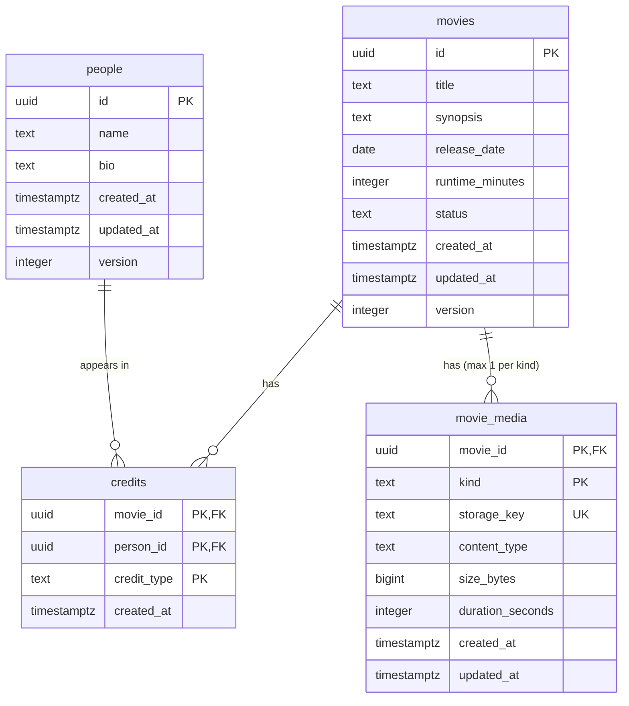

# Database design

Status: **built** (`V1__create_movie_tables.sql`). Postgres 18, **one database** (`app`) and **one schema** (`movie`).

Scope:
- **movie-service** owns **all the data**: movies, cast/creators (people + credits), search, and the *records* of each movie's media (artwork, preview clip, full video).
- **media-service** has **no database**. How files are stored and moved is in [backend-design.md](backend-design.md).

---

## 1. Layout

```
Postgres container (postgres:18)
└── database: app
    ├── schema: movie   ← owned by role movie   (used only by movie-service)
    └── schema: public  ← only the pg_trgm extension lives here
```

| | movie-service | media-service |
|---|---|---|
| Database access | user `movie` / password `movie`, schema `movie` | **none** |
| Migrations | Flyway, history in `movie.flyway_schema_history` | none |

**Why there's no media schema.** The media *records* sit in the **same schema as the movies**, so they get a **real foreign key** with `ON DELETE CASCADE`. Postgres itself guarantees there's never a media record for a movie that doesn't exist.

The trade-off: media metadata lives in movie-service's schema, so a new media column means a movie-service migration. That's fine at this size. At scale, with transcoding status, renditions and subtitles, you'd give media its own schema and data.

**Why a `movie` schema and a `movie` user, not just `public` and the superuser:**
- Least privilege: the app's user can only touch its own schema, not create roles or databases.
- Postgres's default `search_path` is `"$user", public`. Because the user is named after the schema, table names like `movies` resolve to `movie.movies` automatically, and `pg_trgm` is still found in `public`. The connection URL stays plain: `jdbc:postgresql://postgres:5432/app`.

### Bootstrap script (runs as the superuser, once, on an empty volume)

The file is `infra/postgres/init/01-role-and-schema.sql`, mounted into `/docker-entrypoint-initdb.d/`:

```sql
CREATE ROLE movie LOGIN PASSWORD 'movie';
CREATE SCHEMA movie AUTHORIZATION movie;

-- Trigram search (§5). Extensions are per database; it goes in public.
CREATE EXTENSION IF NOT EXISTS pg_trgm;
```

| Who creates it | What |
|---|---|
| Init script (superuser, once) | role, schema, extension |
| Flyway (movie-service, as `movie`, on every start-up) | tables, indexes |

Init scripts only run on an empty volume, and Flyway refuses to start if an applied migration has changed. After editing either one, reset with `docker compose down -v`.

---

## 2. Naming conventions

| Thing | Rule | Example |
|---|---|---|
| Schema | service domain, singular | `movie` |
| Table | snake_case, **plural** | `movies`, `people`, `credits` |
| Child / join table | `<parent singular>_<child plural or mass noun>` | `movie_media` |
| Primary key | `id` (uuid) for entities; composite natural key for link and child tables | `movies.id`; `credits (movie_id, person_id, credit_type)` |
| Foreign key column | `<singular>_id` | `movie_id`, `person_id` |
| File pointer | `storage_key`: path relative to media-service's media folder, **never a URL or an absolute path** | `{movieId}/artwork/{uuid}.jpg` |
| Enum-like column | `text`, values in UPPER_SNAKE, allowed values checked by the application | `credit_type`: `CAST`, `CREATOR` |
| Timestamps | `created_at`, `updated_at`, type `timestamptz` | |
| Optimistic lock | `version integer` | |
| Primary key constraint | `pk_<table>` | `pk_movies` |
| Foreign key constraint | `fk_<table>_<column>` | `fk_credits_movie_id` |
| Unique | `uq_<table>_<columns>` | `uq_movie_media_storage_key` |
| Index | `idx_<table>_<columns>[_<kind>]` | `idx_people_name_trgm` |
| Migration file | `V<n>__<verb>_<what>.sql` | `V1__create_movie_tables.sql` |
| Role (and password) | same as the schema it owns | `movie` |

### Why these choices
- **Plural tables.** A singular name would give `movie.movie`, which is confusing. Also, `user` and `order` are reserved words; plural names avoid that whole problem. (`media` is already plural, the plural of "medium".)
- **UUIDv7 primary keys** (`uuidv7()`, built in since Postgres 18).
  - Ids cross services (media-service sends movie ids) and show up in URLs and file paths.
  - v7 starts with a millisecond timestamp, so new ids are always larger than old ones: inserts go to the end of the index instead of random pages, and sorting by `id` is roughly sorting by creation time. The rest is random, so ids still can't be guessed and don't reveal how many rows exist; they do reveal when a row was created, which is fine for movies and people.
  - The cost is a larger index than `bigint`, which doesn't matter at this size.
- **No `CHECK` constraints; value rules live in the application.** Lengths, allowed values and size limits are validated in movie-service (and media-service for files), where they're unit-tested and can change without a migration. The database keeps only structure: types, `NOT NULL`, keys and foreign keys.
- **Except uniqueness.** A `UNIQUE` constraint isn't a value rule: it depends on *other rows*. The application can't enforce it safely, because two concurrent requests can both check "no duplicate yet" and both insert. Only the database sees both inserts and rejects the second.
- **`text` instead of `CREATE TYPE ... AS ENUM`.** Removing a value from a Postgres ENUM is not supported at all; with `text`, changing the allowed values is an application change.
- **`text` instead of `varchar(n)`.** In Postgres they perform the same, and length limits are checked by the application.
- **Named constraints.** A violation error names the rule, for example `pk_credits`, so the backend can turn it into a clear message.
- **`timestamptz`.** It stores an absolute moment in UTC. Plain `timestamp` has no time zone, which is a common source of bugs.

---

## 3. Tables



### Why `people` + `credits` and not `cast` and `creators` tables
The spec says "cast and creators". One person can be a creator on one film and cast in another, or both on the same film. So:
- **`people`** says *who someone is* (name, bio). This is the list you add, edit and delete on a "Cast & Creators" page.
- **`credits`** says *what they did on one movie*: `credit_type` is `CAST` or `CREATOR`.

With separate `cast` and `creators` tables, someone who was both a creator and cast would be stored twice, and editing their bio would mean editing two rows.

The **Rule** columns below are enforced by the application, not the database (see §2), except where they say PK, FK or unique.

### `movies`

| Column | Type | Null | Default | Rule |
|---|---|---|---|---|
| `id` | uuid | no | `uuidv7()` | PK |
| `title` | text | no | | not blank, ≤ 200 chars |
| `synopsis` | text | yes | | ≤ 5000 chars |
| `release_date` | date | yes | | unknown release date is allowed |
| `runtime_minutes` | integer | yes | | 1–1000 |
| `status` | text | no | `'DRAFT'` | `DRAFT` or `PUBLISHED`; only published movies appear in the public list and search |
| `created_at` | timestamptz | no | `now()` | |
| `updated_at` | timestamptz | no | `now()` | |
| `version` | integer | no | `0` | goes up by 1 on every update |

- **Indexes:** a trigram GIN index on `title`, for search (§5). None on `status`: with two values, each matching a large share of rows, Postgres would scan the table anyway.

### `people`

| Column | Type | Null | Default | Rule |
|---|---|---|---|---|
| `id` | uuid | no | `uuidv7()` | PK |
| `name` | text | no | | not blank, ≤ 200 |
| `bio` | text | yes | | ≤ 5000 |
| `created_at`, `updated_at` | timestamptz | no | `now()` | |
| `version` | integer | no | `0` | goes up by 1 on every update |

- **Indexes:** a trigram GIN index on `name`.

### `credits`

| Column | Type | Null | Default | Rule |
|---|---|---|---|---|
| `movie_id` | uuid | no | | PK part; FK → `movies`, **cascade** |
| `person_id` | uuid | no | | PK part; FK → `people`, **cascade** |
| `credit_type` | text | no | | PK part; `CAST` or `CREATOR` |
| `created_at` | timestamptz | no | `now()` | |

- **Primary key `(movie_id, person_id, credit_type)`:** the same person can't be added twice to a movie in the same capacity (e.g. a double-clicked "Add cast"). They can still be both `CAST` and `CREATOR` on one movie.
- **Indexes:** `idx_credits_person_id`. **Postgres does not index foreign key columns automatically.** `movie_id` is already covered because it's the first column of the primary key. `person_id` isn't, and without an index both "movies this person is in" and the cascade when a person is deleted would scan the whole table.
- **No separate `id`:** a credit has no fields of its own; it's a link between a movie and a person. Nothing needs to refer to it except by those three values (removing one is `DELETE … WHERE movie_id = ? AND person_id = ? AND credit_type = ?`), so the natural key is the primary key, the same as `movie_media`. One constraint and one index instead of an `id`, a primary key and a separate unique constraint.

### `movie_media`

The *record* of each file attached to a movie (artwork, preview clip, full video). The files themselves live on media-service's volume.

| Column | Type | Null | Default | Rule |
|---|---|---|---|---|
| `movie_id` | uuid | no | | PK part; FK → `movies`, **cascade** |
| `kind` | text | no | | PK part; `ARTWORK` (poster), `PREVIEW` (hover trailer) or `FULL` (click to play) |
| `storage_key` | text | no | | unique; file path under media-service's media folder, e.g. `{movieId}/artwork/{uuid}.jpg` |
| `content_type` | text | no | | must match the kind: `image/jpeg`, `image/png` or `image/webp` for `ARTWORK`; `video/mp4` or `video/webm` for `PREVIEW` / `FULL` |
| `size_bytes` | bigint | no | | > 0; ARTWORK ≤ 5 MB, PREVIEW ≤ 25 MB, FULL ≤ 500 MB |
| `duration_seconds` | integer | yes | | > 0; videos only, must be null for `ARTWORK` |
| `created_at`, `updated_at` | timestamptz | no | `now()` | |

- **Primary key `(movie_id, kind)`:** at most one artwork, one preview and one full video per movie. Uploading a new one **replaces** the row (upsert). There's no separate `id`, because nothing needs to refer to a file other than as "movie X's artwork".
- **Why one table for artwork and videos:** they're the same thing to the database: a file of some kind, attached to a movie, with a type and a size. The differences between kinds (allowed types, size limits) are value rules, so they live in the application. A gallery of several images per movie would need a different key, but we don't need that.
- **No `version`:** a file is only ever replaced as a whole, never edited, so there's no lost-update risk to guard against.
- **`bigint` for size:** `integer` tops out at about 2.1 GB. That's fine for our 500 MB limit, but real films are bigger.

### Delete behaviour

| Delete a… | Rows removed with it |
|---|---|
| movie | its `credits` and `movie_media` (cascade); the `people` stay |
| person | their `credits` (cascade), including credits on published movies; the `movies` stay |

---

## 4. Migrations

**`V1__create_movie_tables.sql`**
```sql
-- Value rules (lengths, allowed values, size limits) are enforced in the application, not with CHECKs.
-- The database keeps only structure: types, NOT NULL, keys and foreign keys.

CREATE TABLE movies (
    id              uuid        NOT NULL DEFAULT uuidv7(),
    title           text        NOT NULL,
    synopsis        text,
    release_date    date,
    runtime_minutes integer,
    status          text        NOT NULL DEFAULT 'DRAFT',  -- DRAFT | PUBLISHED (validated by the application)
    created_at      timestamptz NOT NULL DEFAULT now(),
    updated_at      timestamptz NOT NULL DEFAULT now(),
    version         integer     NOT NULL DEFAULT 0,
    CONSTRAINT pk_movies PRIMARY KEY (id)
);
CREATE INDEX idx_movies_title_trgm ON movies USING gin (title gin_trgm_ops);

CREATE TABLE people (
    id         uuid        NOT NULL DEFAULT uuidv7(),
    name       text        NOT NULL,
    bio        text,
    created_at timestamptz NOT NULL DEFAULT now(),
    updated_at timestamptz NOT NULL DEFAULT now(),
    version    integer     NOT NULL DEFAULT 0,
    CONSTRAINT pk_people PRIMARY KEY (id)
);
CREATE INDEX idx_people_name_trgm ON people USING gin (name gin_trgm_ops);

CREATE TABLE credits (
    movie_id    uuid        NOT NULL,
    person_id   uuid        NOT NULL,
    credit_type text        NOT NULL,  -- CAST | CREATOR (validated by the application)
    created_at  timestamptz NOT NULL DEFAULT now(),
    CONSTRAINT pk_credits PRIMARY KEY (movie_id, person_id, credit_type),
    CONSTRAINT fk_credits_movie_id  FOREIGN KEY (movie_id)  REFERENCES movies (id) ON DELETE CASCADE,
    CONSTRAINT fk_credits_person_id FOREIGN KEY (person_id) REFERENCES people (id) ON DELETE CASCADE
);
-- Postgres doesn't index foreign keys automatically. movie_id is covered by the primary key
-- (its first column); person_id needs its own index for "movies of person X" and the cascade.
CREATE INDEX idx_credits_person_id ON credits (person_id);

CREATE TABLE movie_media (
    movie_id         uuid        NOT NULL,
    kind             text        NOT NULL,  -- ARTWORK | PREVIEW | FULL (validated by the application)
    storage_key      text        NOT NULL,
    content_type     text        NOT NULL,
    size_bytes       bigint      NOT NULL,
    duration_seconds integer,
    created_at       timestamptz NOT NULL DEFAULT now(),
    updated_at       timestamptz NOT NULL DEFAULT now(),
    CONSTRAINT pk_movie_media PRIMARY KEY (movie_id, kind),
    CONSTRAINT fk_movie_media_movie_id FOREIGN KEY (movie_id) REFERENCES movies (id) ON DELETE CASCADE,
    CONSTRAINT uq_movie_media_storage_key UNIQUE (storage_key)
);
-- No extra index: the primary key (movie_id, kind) already serves "media of movie X".
```

---

## 5. Search indexes

- **Why a trigram index:** a normal B-tree index can't help a search with a leading wildcard (`ILIKE '%godf%'`). A trigram GIN index (`gin_trgm_ops`) splits text into 3-letter chunks, so substring search on `movies.title` and `people.name` is indexed, and `similarity()` can rank close matches.
- **Cast and creator filters** match `people.name` through `credits`, so they rely on this index and the `credits` primary key. No new index is needed.
- **Search terms under 3 characters** have no trigrams, so the index can't narrow them down and Postgres scans the table. The results are still correct, and the scan is fast at this size.

---

## 6. How this affects the backend

| DB decision | What the backend must do |
|---|---|
| One user + schema, both named `movie` | movie-service connects as `movie`/`movie` to `jdbc:postgresql://postgres:5432/app`. The default `search_path` handles the schema. media-service gets **no** datasource and no JDBC/Flyway dependencies. |
| Flyway | Only movie-service: `spring.flyway.schemas=movie`, migrations in `src/main/resources/db/migration`. |
| `storage_key` stores relative paths, not URLs | URLs are built when data is read, so storage can move (volume → S3) without touching data. |
| `version` column on `movies` / `people` | Update, publish and delete requests must send the version the client last saw. 0 rows updated means someone else changed it, so return a "conflict, please reload" error. |
| No `CHECK`s | movie-service validates every value rule on its data (title not blank, lengths, allowed `credit_type` / `kind`) before writing, and media-service checks file types and size limits. Both return INVALID_ARGUMENT. These rules get unit tests with edge cases. |
| Named `pk_`/`uq_`/`fk_` constraints | The backend maps constraint names to friendly errors, e.g. `pk_credits` → ALREADY_EXISTS ("Already credited as cast on this movie"), `fk_movie_media_movie_id` → NOT_FOUND. |
| `updated_at` | Set by the application on update. There's no database trigger, so the logic stays in tested Kotlin. |

---

## 7. Decisions

Decided:
- One database `app`, one schema `movie`, user `movie`/`movie`.
- movie-service owns all data, including the `movie_media` records. media-service has no database; it handles all media files, artwork and videos alike.
- No `CHECK` constraints; value rules live in the application. Uniqueness stays in the database (`pk_credits`, `uq_movie_media_storage_key`).
- Removed to match the spec: genres, `people.birth_date`, `credits.role` / `billing_order`, and the unique title + release date on `movies` (duplicate movie titles are allowed).
- Deleting a person cascades to their credits.
- Movies have a `status` (`DRAFT` / `PUBLISHED`); every movie starts as a draft.
