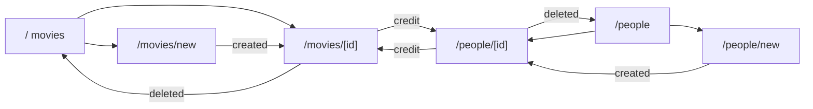

# Frontend design

Status: **built**. This doc covers the pages, how they load and change data, and how they look. The GraphQL schema and the flows behind it are in [backend-design.md](backend-design.md).

---

## 1. Overview

The frontend is a SvelteKit app that runs entirely in the browser (`ssr = false`) and talks to the gateway at `GRAPHQL_URL`.

| Choice | Decision | Why |
|---|---|---|
| **GraphQL client** | The existing `graphqlRequest` helper | About 10 operations and no shared cache to manage. A page refetches after a change. |
| **Types** | Hand-written in `lib/api/types.ts` | A code generator would add more setup than it saves at this size. |
| **Rendering** | Browser only | Every page loads its data the same way, with the same loading and error states. |
| **Styling** | daisyUI classes on Tailwind | Ready-made themes and components. Both run at build time, so they add CSS and no JavaScript to the browser, and components keep their own logic. |

No new runtime dependencies are needed: `tailwindcss`, `@tailwindcss/vite` and `daisyui` are dev dependencies.

---

## 2. Pages

| Route | Shows | Actions |
|---|---|---|
| `/` | Movie grid with artwork | Search, change page, go to a new movie |
| `/movies/new` | Empty movie form | Create, then go to the movie's page |
| `/movies/[id]` | Artwork, details, cast and creators | Edit, upload artwork, add or remove credits, delete |
| `/people` | List of cast and creators | Search, change page, go to a new person |
| `/people/new` | Empty person form | Create, then go to the person's page |
| `/people/[id]` | Name, bio and the person's movies | Edit, delete |



Artwork is uploaded from `/movies/[id]`, because an upload needs the movie's id. Creating a movie with artwork is therefore two steps: fill in the form, then upload on the page it opens.

### Movie list

```
Desktop                                      Phone
┌────────────────────────────────────────┐   ┌──────────────────┐
│ Movies  People                         │   │ Movies  People   │
│ [ heat cast:david          ] [Search]  │   │ [ search    ] [→]│
│                            [New movie] │   │ [New movie]      │
│ ┌────┐ ┌────┐ ┌────┐ ┌────┐ ┌────┐     │   │ ┌──────┐┌──────┐ │
│ │art │ │art │ │art │ │art │ │art │     │   │ │ art  ││ art  │ │
│ └────┘ └────┘ └────┘ └────┘ └────┘     │   │ └──────┘└──────┘ │
│ Heat    Alien  Up     Jaws   Big       │   │ Heat    Alien    │
│ 1995    1979   2009   1975   1988      │   │ 1995    1979     │
│           ‹ Prev  Page 1 of 3  Next ›  │   │ ‹ Prev 1/3 Next ›│
└────────────────────────────────────────┘   └──────────────────┘
```

### Movie page

```
Desktop                                      Phone
┌────────────────────────────────────────┐   ┌──────────────────┐
│ ┌────────┐  Heat            [Edit][Del]│   │ ┌──────────────┐ │
│ │  art   │  1995 · 170 min             │   │ │     art      │ │
│ │        │  Synopsis text…             │   │ └──────────────┘ │
│ └────────┘                             │   │ [Choose file]    │
│ [Choose file]  Cast                    │   │ ▓▓▓▓░░░ 58%      │
│ ▓▓▓▓░░░ 58%    Al Pacino           [×] │   │ Heat             │
│                [+ add a person]        │   │ 1995 · 170 min   │
│                Creators                │   │ [Edit][Del]      │
│                Michael Mann        [×] │   │ Cast …           │
│                [+ add a person]        │   │ Creators …       │
└────────────────────────────────────────┘   └──────────────────┘
```

**Edit** swaps the details for the same form `/movies/new` uses.

---

## 3. Code layout

```
frontend/src
├── app.css                        loads Tailwind and daisyUI, and picks the theme
├── env.ts                         GRAPHQL_URL
├── lib
│   ├── api
│   │   ├── graphql.ts             sends a request and reads the response or error
│   │   ├── loader.svelte.ts       a page's fetched data, loading and error state
│   │   ├── movies.ts              movie and credit operations
│   │   ├── people.ts              people operations
│   │   ├── upload.ts              the artwork upload, with progress
│   │   └── types.ts               Movie, Person, MovieInput, …
│   ├── artwork-file.ts            the size and extension check
│   ├── list-url.ts                reads and builds a list page's search and page number
│   ├── search.ts                  splits the search box text into filters
│   └── components
│       ├── Artwork.svelte         a movie's image, or a placeholder
│       ├── ArtworkUpload.svelte   file input, progress bar, upload errors
│       ├── CreditList.svelte      one credit type's people, add and remove
│       ├── ErrorMessage.svelte    an error with a Retry button
│       ├── Initials.svelte        a name's initials on a colour worked out from the name
│       ├── MovieCard.svelte       artwork, title and year in the grid
│       ├── MovieForm.svelte       the fields and their errors, for create and edit
│       ├── Pagination.svelte      previous, next and "Page 1 of 3"
│       ├── PersonForm.svelte      the fields and their errors, for create and edit
│       ├── PersonPicker.svelte    searches people to credit
│       ├── SearchBox.svelte       the search input on both list pages
│       └── Spinner.svelte
└── routes
    ├── +layout.svelte             navigation and page width
    ├── +layout.ts                 ssr = false
    ├── +page.svelte               /
    ├── movies/new/+page.svelte
    ├── movies/[id]/+page.svelte
    ├── people/+page.svelte
    ├── people/new/+page.svelte
    └── people/[id]/+page.svelte
```

---

## 4. Loading data

Each page creates a `Loader` (`lib/api/loader.svelte.ts`), which holds `data`, `loading` and `error` and fetches in a Svelte `$effect`. SvelteKit's `load` function waits for the data before showing the page, which would leave nothing on screen to show progress.

```ts
const movies = new Loader(() =>
	listMovies({ ...parseSearch(searchText), page: pageNumber - 1, pageSize: PAGE_SIZE })
);
```

- **Refetching:** the effect runs again when a reactive value read before the function's first `await` changes, here `searchText` or `pageNumber`. `movies.reload()` refetches on demand, for Retry and after a change.
- **Out-of-order answers:** each request gets a number, and only the latest may update the state, so a slow older answer can't overwrite a newer one.

- **Search and page live in the URL** (`/?q=heat+cast:david&page=2`), so refresh and the back button keep them. Searching and changing page call `goto`, and the effect refetches when the URL changes.
- **Search runs on submit,** when the user presses Enter or the button. This keeps requests to one per search, with no debounce timer.
- **Pages are shown from 1 and sent from 0.** `page=2` in the URL requests `page: 1`, with a page size of 20.
- **Queries ask only for what the page shows.** The movie grid leaves out `credits`; the movie page includes them.
- **Changes refetch.** After an edit or a credit change, the page loads the movie again. An artwork upload replaces the image using the URL it returns.

---

## 5. Progress feedback

| Action | While it runs | If it fails |
|---|---|---|
| **Listing, searching** | Spinner on first load; afterwards the previous results stay, dimmed, with a spinner | `ErrorMessage` with Retry |
| **Opening a movie or person** | Spinner | `ErrorMessage` with Retry, or "not found" when the query returns `null` |
| **Creating, updating** | Button disabled, reading "Saving…" | Messages beside the fields, plus a banner for other errors |
| **Deleting** | Native `confirm()`, then button disabled, reading "Deleting…". For a person, the confirmation says they'll be removed from their movies | Banner on the page |
| **Uploading artwork** | Progress bar with a percentage; "Finishing…" at 100% until the response arrives | Message under the file input |
| **Adding, removing credits** | That row's button disabled | Message beside the list |

Empty results show "No movies found" or "No people found".

---

## 6. Errors

`graphqlRequest` throws a `GraphQLRequestError`. Its message joins every error's message, and it carries `code` and `fieldErrors` from the first error, for the forms. `formErrors` splits a failed save into messages for the form's fields and a banner for anything else.

| Gateway code | What the user sees |
|---|---|
| `BAD_USER_INPUT` | Each entry in `fieldErrors` beside its field (`title`, `synopsis`, `releaseDate`, `runtimeMinutes`, `name`, `bio`), otherwise a banner |
| `NOT_FOUND`, `CONFLICT` | The gateway's message, such as a duplicate credit |
| `SERVICE_UNAVAILABLE`, `INTERNAL_SERVER_ERROR` | "Something went wrong, try again" |
| Gateway unreachable | "Could not reach the gateway. Is it running?" |

---

## 7. Forms

- **The server owns the rules.** The rules in the `.proto` files decide what's valid, and their messages appear beside the fields. The form only adds browser hints: `required` and `maxlength` on the title, `maxlength` on the synopsis, `type="date"`, and `type="number"` with `min` and `max` on the runtime. The person form has `required` and `maxlength` on the name and `maxlength` on the bio.
- **Empty fields are sent as `null`.** An empty `<input>` gives `""`, which would fail the date check. Saving always sends every field, because `updateMovie` and `updatePerson` replace them.
- **Values stay in the form when saving fails,** so the user can correct them.

---

## 8. Search box

`parseSearch` in `lib/search.ts` applies the syntax from backend-design §3.7:

| Input | `search` | `castName` | `creatorName` |
|---|---|---|---|
| `heat` | `heat` | | |
| `heat cast:david creator:"michael mann"` | `heat` | `david` | `michael mann` |
| `cast:david cast:al` | | `al` | |
| `cast: amy` | | `amy` | |
| `year:1995 heat` | `year:1995 heat` | | |

A hint under the movie search box explains the filters. The people page sends its box's text directly as `search`, with no syntax.

A person without a bio shows "No bio", on both the list and their page.

---

## 9. Artwork upload

1. `checkArtworkFile` in `lib/artwork-file.ts` rejects anything over 5 MB or without a `.jpg`, `.jpeg` or `.png` extension. The input also has `accept=".jpg,.jpeg,.png"`.
2. `uploadArtwork` in `lib/api/upload.ts` sends a [GraphQL multipart request](https://github.com/jaydenseric/graphql-multipart-request-spec) with `XMLHttpRequest`, because `fetch` doesn't report upload progress. It needs the `apollo-require-preflight` header.
3. The response goes through the same error handling as `graphqlRequest`.

```ts
const form = new FormData();
form.append('operations', JSON.stringify({ query: UPLOAD_ARTWORK, variables: { movieId, file: null } }));
form.append('map', JSON.stringify({ 0: ['variables.file'] }));
form.append('0', file);

xhr.upload.onprogress = (e) => onProgress(e.loaded / e.total);
```

---

## 10. Credits

The movie page shows a `CreditList` each for cast and creators, so the list decides the credit's type.

- **Adding:** "+ Add" opens `PersonPicker`, which searches `people(search, pageSize: 10)` on submit and lists the matches. Choosing one calls `addCredit`. When nobody matches, it links to `/people/new`.
- **Removing:** the row's × calls `removeCredit`, with no confirmation, because it's easy to add back.
- **Linking:** each name opens that person's page.

The same person can be both cast and creator on one movie. Adding the same credit twice shows the gateway's `CONFLICT` message. Changing a credit's type is a remove followed by an add.

---

## 11. Look and responsive layout

| Element | Rule |
|---|---|
| **Page** | Centred, at most 1152px wide (`max-w-6xl`), with a 16px gutter on phones |
| **Movie grid** | Two columns on a phone, rising to five on a wide screen |
| **Artwork** | 2:3 with `object-cover`, so cards line up whatever the image's shape; `loading="lazy"` in the grid. A movie without artwork shows its initials on a colour worked out from its title |
| **Movie page** | Two columns from 768px, one below it |
| **People list** | Cards with initials: one column on a phone, two from 768px |
| **Controls** | daisyUI's default sizes |
| **Theme** | daisyUI's dark `night` theme, set in `app.css` |

---

## 12. Build order

1. **Foundation:** Tailwind and daisyUI, layout with navigation, `ssr = false`, `graphqlRequest` errors, types, `Spinner`, `ErrorMessage`, `Pagination`.
2. **Movies:** list and search, then create, edit and delete.
3. **People:** list and search, detail page, then create, edit and delete.
4. **Artwork and credits:** upload with progress, then adding and removing credits.
5. **Final pass:** check phone widths and every state in §5, then do a full local run-through.

Frontend tests follow [unit-test-plan.md](unit-test-plan.md).
